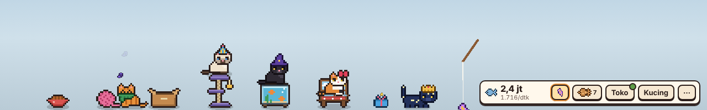

# Meow Corner

Game idle kucing yang tinggal di strip bawah layar desktop. Kucing-kucing berjalan, tidur, makan, dan mengumpulkan ikan selagi Anda bekerja. Dibuat dengan **Tauri 2 + TypeScript + PixiJS**, tanpa game engine.



## Unduh dan main

Buka halaman **[Releases](https://github.com/iniArsat/meow-corner/releases/latest)**, unduh file yang berakhiran `-setup.exe`, lalu klik dua kali untuk memasang. Installer dibuat otomatis oleh GitHub Actions setiap ada perubahan di branch `main`.

## Isi versi 0.1 (MVP)

- **Strip transparan** selebar layar, menempel di atas taskbar, selalu di atas jendela lain.
- **Klik tembus per area**: klik di ruang kosong diteruskan ke aplikasi di belakang; hanya kucing, fasilitas, dan UI yang bisa diklik.
- **6 fasilitas** (Mangkuk makan sampai Rak jendela) dengan harga naik 15% per pembelian, plus 18 upgrade.
- **18 jenis kucing** dalam 4 kelangkaan, semuanya pixel art yang digambar oleh kode (tanpa file gambar).
- **5 sifat kucing** yang memengaruhi produksi: Pemalas, Aktif, Rakus, Penjelajah, Manja.
- **Kucing liar**: mampir sesekali, beri makan 3 kali, lalu adopsi dan beri nama.
- **Rasa lapar** tanpa hukuman berat (kucing lapar hanya kurang produktif), **elusan** memberi bonus semangat.
- **Ikan berkilau** yang muncul acak untuk bonus kecil.
- **Progres offline** 50% sampai 8 jam (bisa ditingkatkan sampai 24 jam).
- **Pindah Rumah** (prestige): reset fasilitas, dapat Bintang untuk bonus permanen.
- **Kucingpedia**, Mode Fokus (animasi tenang, hemat daya), efek suara opsional.
- **Ikon tray** (Tampilkan/Sembunyikan, Keluar), strip otomatis bersembunyi saat ada game atau aplikasi layar penuh (Windows).
- **Simpan otomatis** tiap 60 detik dan saat keluar, dengan file cadangan.

## Cara termudah di Windows: klik dua kali

1. Ekstrak `meow-corner.zip` (klik kanan → **Extract All**).
2. Buka folder hasil ekstrak, lalu klik dua kali **`PASANG-WINDOWS.bat`**.
   - Bila muncul "Windows protected your PC", klik **More info** → **Run anyway**.
   - Bila muncul jendela izin (UAC), klik **Yes**.
3. Biarkan jendela hitam bekerja. Ia memasang Node.js, Visual Studio Build Tools (C++), dan Rust lewat winget bila belum ada, lalu menyiapkan proyek. Pertama kali bisa 30–60 menit, tergantung internet.
4. Saat ditanya, ketik **1** lalu Enter untuk membuat installer. Installer Meow Corner akan terbuka sendiri; ikuti langkahnya, dan game muncul di Start Menu.

Bila ada langkah yang gagal, pesan errornya tampil di jendela itu. Langkah manual di bawah bisa dipakai sebagai cadangan.

## Menjalankan di Windows (manual)

### 1. Pasang prasyarat (sekali saja)

1. **Node.js 20 atau lebih baru**: unduh versi LTS dari <https://nodejs.org>.
2. **Rust**: unduh dan jalankan `rustup-init.exe` dari <https://rustup.rs>, pilih instalasi bawaan.
3. **Microsoft C++ Build Tools**: dari <https://visualstudio.microsoft.com/visual-cpp-build-tools/>, centang **"Desktop development with C++"**.
4. **WebView2** sudah terpasang di Windows 10 (versi terbaru) dan Windows 11.

Panduan resmi lengkap: <https://v2.tauri.app/start/prerequisites/>.

### 2. Jalankan mode pengembangan

Buka terminal (PowerShell) di folder proyek ini:

```powershell
npm install
npm run tauri dev
```

Build pertama Rust memakan beberapa menit; berikutnya jauh lebih cepat. Strip akan muncul di bawah layar. Untuk keluar, klik kanan ikon kucing di tray lalu pilih **Keluar**, atau buka menu **⋯ → Atur → Keluar**.

### 3. Buat installer

```powershell
npm run tauri build
```

Installer ada di `src-tauri/target/release/bundle/nsis/` (`.exe`) dan `src-tauri/target/release/bundle/msi/` (`.msi`).

## Mengembangkan di browser saja

Untuk mengerjakan tampilan dan gameplay tanpa menunggu build Rust:

```powershell
npm run dev
```

Lalu buka <http://localhost:1420>. Klik tembus dan tray tidak aktif di mode ini, tetapi semua gameplay jalan. Di konsol DevTools tersedia objek `meow` untuk menguji cepat, misalnya:

```js
meow.game.state.fish = 1e6;          // banyak ikan untuk mencoba toko
meow.game.callVisitor(Date.now());   // panggil kucing liar
```

## Perintah lain

| Perintah | Fungsi |
| --- | --- |
| `npm test` | Menjalankan 35 tes unit (ekonomi, alur game, simpanan, sprite) |
| `npm run typecheck` | Pemeriksaan tipe TypeScript |
| `npm run build` | Build frontend ke `dist/` |

## Struktur kode

```
src/
  core/        Logika murni, tanpa tampilan (mudah diuji)
    data.ts      Semua angka balancing, daftar kucing, fasilitas, upgrade
    economy.ts   Rumus harga, produksi, offline, prestige
    game.ts      Simulasi dan aksi pemain, mengirim event
    state.ts     State awal dan migrasi simpanan
    save.ts      Simpan/muat dengan cadangan
  render/      Tampilan PixiJS
    pixelart.ts  Generator pixel art (pose kucing, pola bulu, fasilitas)
    stage.ts     Strip, perilaku kucing, tamu, efek partikel
  ui/          HUD, panel, dialog (HTML + CSS)
  platform/    Jembatan ke Tauri dan klik tembus
src-tauri/
  src/lib.rs   Jendela, klik tembus, tray, deteksi layar penuh, file simpanan
tests/         Tes unit Vitest
```

### Mengubah keseimbangan

Semua angka ada di `src/core/data.ts`: harga dan produksi fasilitas, bonus kelangkaan, bobot peluang kucing liar, lama lapar, batas offline, dan konstanta lain di objek `BALANCE`.

### Menambah jenis kucing

Tambahkan entri ke `COATS` di `src/core/data.ts`: pilih kelangkaan, pola (`solid`, `tabby`, `tuxedo`, `calico`, `point`, `spotted`, `starry`), dan palet warna. Sprite dibuat otomatis untuk semua pose. Pratinjau semua sprite ke PNG:

```powershell
$env:PREVIEW="C:\folder\tujuan"; npx vitest run tests/sprites.test.ts
```

## Lokasi file simpanan

- Windows: `%APPDATA%\id.meowcorner.app\save.json` (cadangan: `save.json.bak`)
- macOS: `~/Library/Application Support/id.meowcorner.app/`
- Linux: `~/.local/share/id.meowcorner.app/`

## Batasan yang diketahui

- Deteksi aplikasi layar penuh baru diimplementasikan untuk Windows.
- Belum diuji di macOS. Di Linux, jendela transparan butuh compositor.
- Integrasi Steam (achievement, Steam Cloud) belum ada; rencananya lewat crate `steamworks` di sisi Rust.
- Reaksi terhadap ketikan/klik di aplikasi lain belum ada (butuh hook input global).
- Musik belum ada; efek suara masih sintetis.
